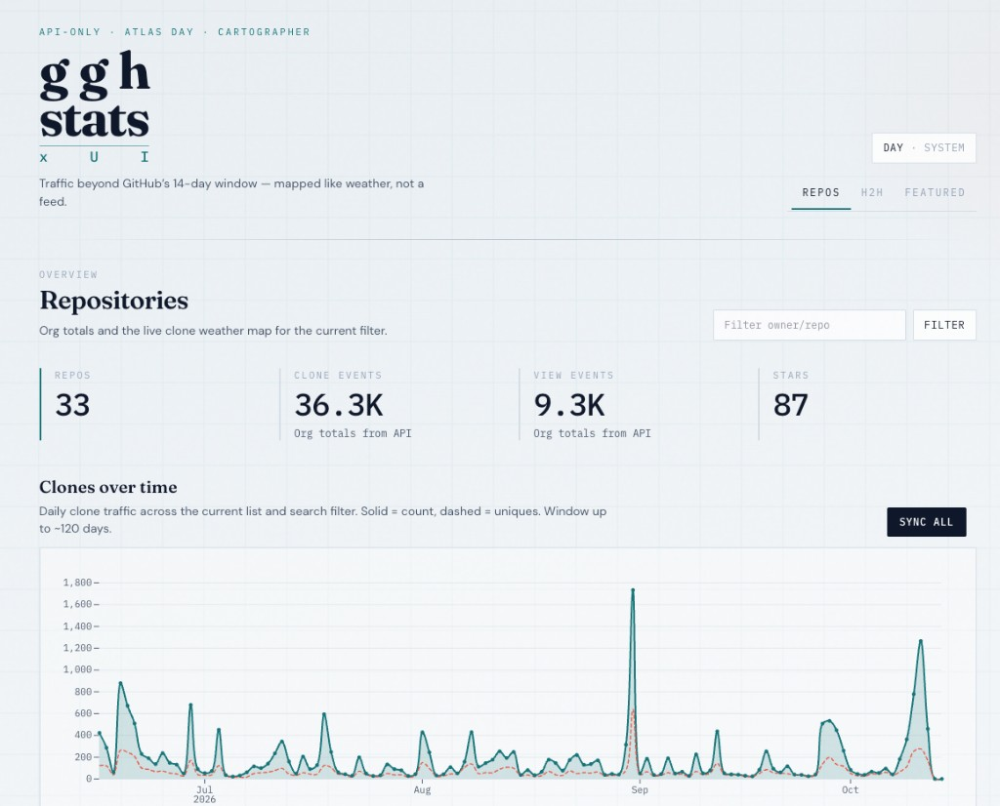
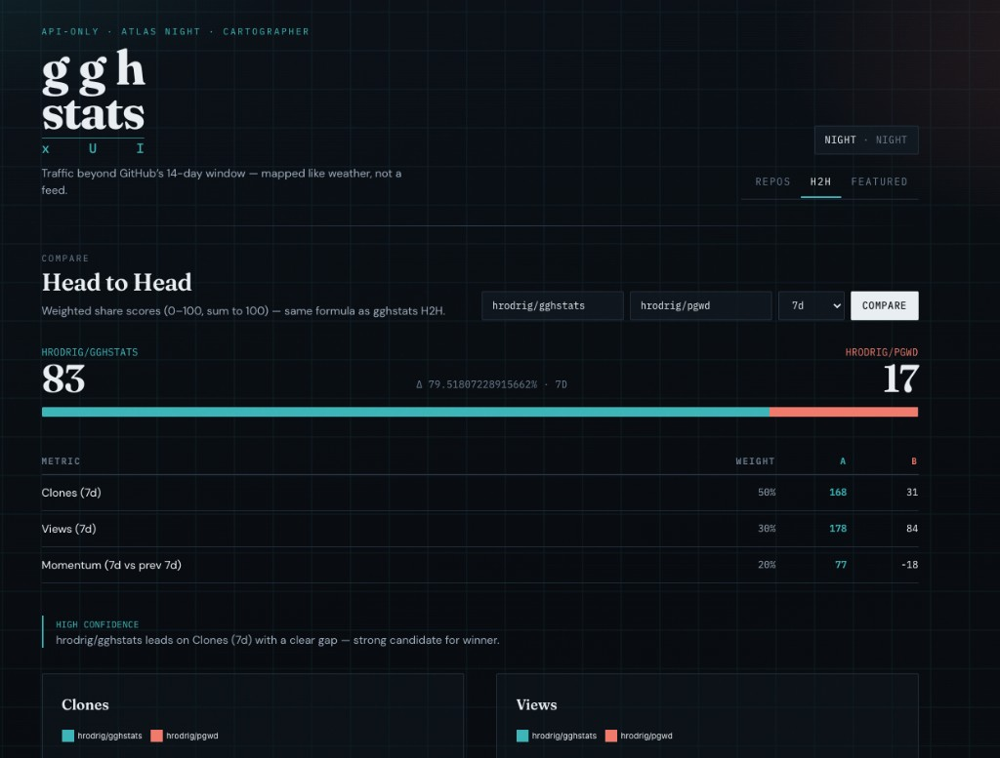
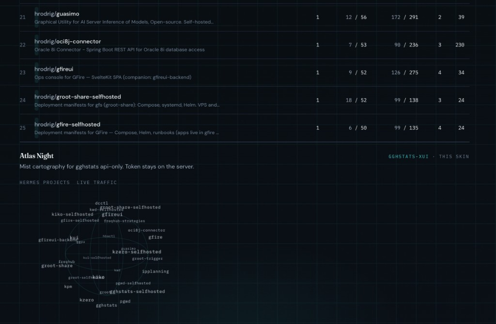

# gghstats-xui

[](https://github.com/hrodrig/gghstats-xui/releases)
[](https://github.com/hrodrig/gghstats-xui/releases)
[](https://github.com/hrodrig/gghstats-xui/actions)
[](https://xui.hermesrodriguez.com/)
[](https://github.com/hrodrig/gghstats-xui/pkgs/container/gghstats-xui)
[](https://gghstats.hermesrodriguez.com/hrodrig/gghstats-xui)
[](https://opensource.org/licenses/MIT)

**Repo:** [github.com/hrodrig/gghstats-xui](https://github.com/hrodrig/gghstats-xui) · **Releases:** [GitHub Releases](https://github.com/hrodrig/gghstats-xui/releases) · **Operator:** [gghstats-xui-selfhosted](https://github.com/hrodrig/gghstats-xui-selfhosted) · **Backend:** [gghstats](https://github.com/hrodrig/gghstats) · **Live:** [xui.hermesrodriguez.com](https://xui.hermesrodriguez.com/) · **Agents:** [AGENTS.md](AGENTS.md)







Reference **Atlas Day / Atlas Night** UI for [gghstats](https://github.com/hrodrig/gghstats) in **API-only** mode — mist cartography for GitHub traffic beyond the 14-day window. SvelteKit SPA → same-origin BFF → `gghstats serve` with `GGHSTATS_API_ONLY=true`. The API token never ships to the browser.

**Why it exists:** prove that **anyone can ship a custom interface** against gghstats JSON. Fork this skin, or write your own (any stack) and point it at an api-only instance. The product goal is **many frontends**, one durable API.

Deploy Compose / Helm: **[gghstats-xui-selfhosted](https://github.com/hrodrig/gghstats-xui-selfhosted)** (`GGHSTATS_XUI_VERSION=v0.1.3`).

**Related tools (same maintainer):**
- **[gghstats](https://github.com/hrodrig/gghstats)** — GitHub repo traffic beyond 14 days ([live demo](https://gghstats.hermesrodriguez.com); deploy: [gghstats-selfhosted](https://github.com/hrodrig/gghstats-selfhosted))
- **[pgwd](https://github.com/hrodrig/pgwd)** — PostgreSQL connection watchdog ([live traffic](https://gghstats.hermesrodriguez.com/hrodrig/pgwd); deploy: [pgwd-selfhosted](https://github.com/hrodrig/pgwd-selfhosted))
- **[kzero](https://github.com/hrodrig/kzero)** — bastion-first declarative workload reset ([live traffic](https://gghstats.hermesrodriguez.com/hrodrig/kzero); deploy: [kzero-selfhosted](https://github.com/hrodrig/kzero-selfhosted))
- **[groot](https://github.com/hrodrig/groot)** — Kubernetes diagnostics archive ([live traffic](https://gghstats.hermesrodriguez.com/hrodrig/groot); deploy: [groot-selfhosted](https://github.com/hrodrig/groot-selfhosted))

**Releases:** annotated tag `v*` on `main` (must match `VERSION`) → multi-arch image `ghcr.io/hrodrig/gghstats-xui:v<version>` + `:latest` (cosign + SBOM). Day-to-day work on `develop` (see [Release workflow](#release-workflow)).

## Table of contents

- [Demo](#demo)
- [Quick start](#quick-start)
- [Surfaces](#surfaces)
- [Stack](#stack)
- [Scripts](#scripts)
- [Docker / GHCR](#docker--ghcr)
- [Design](#design)
- [Release workflow](#release-workflow)
- [Community](#community)
- [License](#license)

## Demo

**Live:** [xui.hermesrodriguez.com](https://xui.hermesrodriguez.com/)

Atlas Day (repos + clone weather) and Atlas Night (H2H + Hermes cartography) — screenshots above.

## Quick start

```bash
cp .env.example .env
# set GGHSTATS_API_BASE + GGHSTATS_API_TOKEN

npm install
npm run dev
```

Open [http://localhost:5173](http://localhost:5173).

### Backend (api-only)

```bash
export GGHSTATS_API_ONLY=true
export GGHSTATS_API_TOKEN=dev-token
export GGHSTATS_CORS_ORIGINS=http://localhost:5173   # optional; BFF avoids browser CORS
gghstats serve
```

Point `.env` at that instance:

```env
GGHSTATS_API_BASE=http://127.0.0.1:8080
GGHSTATS_API_TOKEN=dev-token
```

Or use a remote demo host you control (token required for `/api/repos` and dogfood routes).

Consumer guide for the JSON surface: [gghstats docs/api.md](https://github.com/hrodrig/gghstats/blob/main/docs/api.md).

**[↑ Contents](#table-of-contents)**

## Surfaces

| Route | Upstream |
|-------|----------|
| `/` | `GET /api/repos`, `GET /api/v1/charts/index-clones` |
| `/[owner]/[repo]` | repo summary, traffic (`dense=1`), stars, popular |
| `/h2h` | `GET /api/v1/h2h` |
| `/featured` | `GET /api/v1/featured` |
| Sync button | `POST/GET /api/v1/sync` |

Proxy: browser calls `/api/*` → server adds `x-api-token` → `GGHSTATS_API_BASE`.

The BFF allowlists paths/methods the UI needs (GET for reads, POST only for `/api/v1/sync`) and rejects path traversal. It does **not** replace deploy auth — put the app behind Cloudflare Access, reverse-proxy basic auth, or similar if the host is public.

**[↑ Contents](#table-of-contents)**

## Stack

- SvelteKit 2 + TypeScript + Tailwind CSS v4
- Observable Plot (SVG charts)
- `@sveltejs/adapter-node`

**[↑ Contents](#table-of-contents)**

## Scripts

```bash
npm run dev
npm run build
npm run preview
npm run check
```

Local gate: `make check` / `make build` (see [AGENTS.md](AGENTS.md)).

**[↑ Contents](#table-of-contents)**

## Docker / GHCR

Image: **`ghcr.io/hrodrig/gghstats-xui`** (Node BFF, port **3000**). Pin with `VERSION` / tag `v*` (default selfhosted pin: `v0.1.3`).

```bash
# Local image (amd64)
docker buildx build --platform linux/amd64 \
  --build-arg VERSION="$(tr -d '[:space:]' < VERSION)" \
  -t gghstats-xui:local .

docker run --rm -p 3000:3000 \
  -e GGHSTATS_API_BASE=http://host.docker.internal:8080 \
  -e GGHSTATS_API_TOKEN=dev-token \
  gghstats-xui:local
```

Runtime env (never baked into the image):

| Var | Purpose |
|-----|---------|
| `GGHSTATS_API_BASE` | Upstream gghstats origin (Compose: `http://gghstats:8080`) |
| `GGHSTATS_API_TOKEN` | Shared `x-api-token` for the BFF |
| `HOST` / `PORT` | Defaults `0.0.0.0` / `3000` |

Operator manifests: [gghstats-xui-selfhosted](https://github.com/hrodrig/gghstats-xui-selfhosted).

**[↑ Contents](#table-of-contents)**

## Design

**Atlas Day** — mist daylight atmosphere, Fraunces + DM Sans + IBM Plex Mono, teal/coral accents.

**Atlas Night** — deep slate twin of the same cartography skin (not purple SaaS dark mode). Toggle: System → Day → Night.

Editorial weather-map feel over typical traffic dashboards.

**[↑ Contents](#table-of-contents)**

## Release workflow

Same mold as [gghstats](https://github.com/hrodrig/gghstats):

1. Topic branch (`feature|fix|chore|docs|security/<name>`) → PR → **`develop`**
2. Version bump = solo PR `chore/release-X.Y.Z` on `develop` (`VERSION` + `package.json` + README pins)
3. Ship: PR **`develop` → `main`**, then annotated tag **`vX.Y.Z`** on `main` (triggers GHCR)

Never push `develop` / `main` directly. No `uat`. See `make gitflow` / [AGENTS.md](AGENTS.md).

**CI:** PR/push to `develop`/`main` → quality + Docker build + Grype. **Release:** tag `v*` → multi-arch GHCR + cosign + SBOM.

**[↑ Contents](#table-of-contents)**

## Community

Agent / contrib policy: [AGENTS.md](AGENTS.md). Issues and PRs welcome on GitHub.

**[↑ Contents](#table-of-contents)**

## License

MIT — see [LICENSE](LICENSE).
